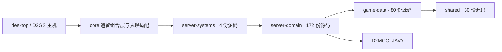

# P2 物理模块边界与验收

第 3/3 批，2026-10-17。已建立四个独立 Gradle 模块，但完整服务器分层仍未达标；不追加第 4 批。

## 实际依赖方向

箭头表示“依赖于”；依赖由 Gradle 的项目声明和独立 javac 编译共同约束。



- `shared`：日志、池、基础工具、Engine/Direction 标识与计算、SyntheticStatIds。日志格式工厂保留不可变 enum 单例；不是游戏世界单例。
- `game-data`：80 份表结构与加载器。ItemTypes 行通过加载时的 put 绑定所属表，不再反查 Riiablo；ItemStatCost 的两个合成 ID 来自共享常量，不再反向依赖属性运行时。
- `server-domain`：独立的任务规则、队伍/交易/宠物等状态与管理器、请求缓存、碰撞与随机计算、独立 ECS 组件/事件和 NativeStatResolver。保留原 Java 包名，调用方不需要大规模改 import。
- `server-systems`：AngularVelocity、ServerNetworkIdManager、Box2DSynchronizerPre 及其 Box2DBody 适配状态。Box2D 仅是物理适配依赖，没有客户端窗口或 UI 依赖。
- 原 ItemUtil、MonsterUtil、ObjectManager 仍使用全局随机源，因此留在 core；PartyServiceProtocol 依赖生成的网络协议，也留在 core。没有用反向依赖 core 的方式强行搬入新模块。

这里的 286 份生产源码中，285 份为物理移动，1 份为共享合成属性 ID。没有把 sourceSets 指向 core 源码目录，也没有把 core/build/classes 塞入新模块类路径。

## 可复验的硬门禁

`gradle/architecture.gradle` 的 `verifyModuleBoundaries` 负责：

1. 新模块项目依赖只能沿白名单方向；检查所有配置，包括测试配置，禁止通过 core 测试依赖绕过边界。
2. 所有项目的生产依赖图不得有环；测试夹具/处理器集成不作为生产环。
3. 新模块不得读取 Riiablo / Files 主机入口、全局 MathUtils.random，且不得引用客户端、screen、widget、graphics、audio 或 GDX 图形/窗口 API；域与系统层还禁止 INSTANCE。
4. 源码必须有唯一模块归属，不得借用模块外源码目录或手工类目录依赖。
5. 每个新模块 compileJava/check 以及 core:architectureRegression/check 都接入门禁。编译器进一步拒绝任何未扫描到的反向类型引用。

`DependencyDirectionTest` 保留原反向 import 门禁，并增加全机制目录的逐文件全局访问增长检查。`architecture-global-access.tsv` 固定旧文件的上限，新文件默认上限为零；计数去除注释和字符串，包含 gameSeed，不能与 rg 匹配行数直接混用。

验收曾临时注入并撤除四种违规：新模块读取 Riiablo、shared 反向依赖 core、生产依赖环、core 新机制文件增加全局访问。四种违规均被相应门禁拒绝，正常代码随后复验。

## 独立构建证据

清空四个新模块输出后运行：

```text
./gradlew.bat :shared:clean :game-data:clean :server-domain:clean :server-systems:clean :shared:test :game-data:test :server-domain:test :server-systems:test
```

通过；实际任务没有 core:compileJava、core:classes 或 core:test。数据表测试 2 项、域测试 11 项、系统测试 2 项全部通过。隔离测试断言运行时加载不到 com.riiablo.Riiablo；数据表测试还断言加载不到属性运行时 Stat。shared 没有独立测试，已实际重新编译。

## 依赖图和剩余循环

工具可从工作区或任意 Git 版本生成源码依赖图，无需修改检出状态：

```text
python tools/architecture/dependencies.py --revision 6e1ac4a43 --output build/reports/architecture/before
python tools/architecture/dependencies.py --output build/reports/architecture/after
```

输出 dependencies.json（类型、归属、依赖、循环群）与 modules.dot（模块图）。扫描涵盖 src/main/java 和 gen/main/java，解析 import、全限定类型和同包类型，包括编译器会内联的常量；显式 import 优先于同包候选。它是保守源码分析，不是完整 Java 语义解析；模块编译才是边界成立的依据。

已提交的 architecture-dependency-summary.json 保存本批摘要与全部剩余循环群。最大 core 循环群从 481 个源类型降为 475 个；源码循环群总数从 27 变为 28（大群拆出小群不代表循环全部消除），没有跨物理模块的循环群。日志、关联表等模块内部类型互相引用允许存在。

## 尚未达到的最终条件

- core 仍包含 Files/Riiablo 主机、属性运行时、Item/ItemWrapper/ItemLabeler、地图生成与 RenderSystem，以及大部分 ECS 战斗/AI 系统；并不是纯表现适配器。
- Skills 的 CharacterClass 兼容 API 仍在 core；没有为了移动数据表引入新的静态主机注册器或破坏旧签名。
- core 服务端的 Riiablo.files/mpqs/gameSeed、MathUtils.random 与 INSTANCE 文本基线仍为 124/5/14/402/3 行；本批建立新模块零遗留边界，不把物理移动宣称为旧全局访问清零。
- 475 个类型的最大遗留循环群仍在 core；共享域和可独立系统已拆出，但整个服务器系统尚不能脱离 core 单独编译。

因此，本批物理拆分和门禁实施已收口，**dark-magic 式完整独立分层的最终验收未通过**。剩余项保留为事实，不标成完成，不启动额外批次。

最终兼容验证：core 编译、架构 3 项、子系统 767 项（2 项跳过）、物品/任务/地图专项 94 项全部通过；D2GS 与 desktop 编译通过。历史存档夹具不足的限制仍见 ARCHITECTURE_REMAINING_WORK.md，不声称全仓库测试全部通过。
